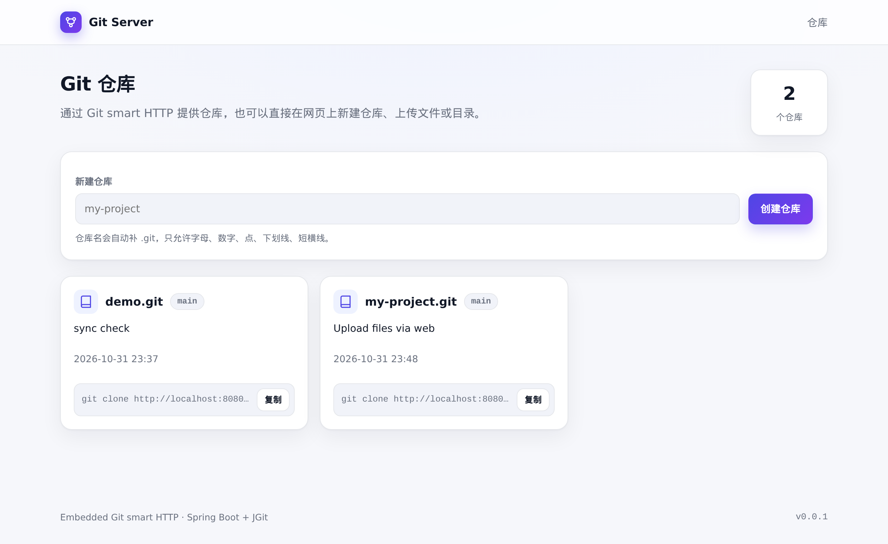

# git-server

一个把 Git 服务端能力直接嵌入业务进程的示例：基于 **Spring Boot 3.5.16 + JGit 7.8.0**，对外提供 Git 的 **smart HTTP 协议**，并附带一个简单网页，用于**新建仓库**、**上传文件或目录**。

不需要安装原生 `git` 服务端，也不需要额外部署 Gitea/GitLab；Git 协议端点就跑在 Spring Boot 的 Tomcat 里。

## 界面预览



## 环境要求

- JDK 17+
- Maven 3.6.3+
- Git 2.34+（仅用于验证客户端）

## 快速开始

```bash
# 构建
mvn -B -DskipTests package

# 运行（二选一）
mvn spring-boot:run
java -jar target/git-server-0.0.1.jar
```

启动后会监听 `8080`，并自动创建示例仓库 `repos/demo.git`。

```bash
# 克隆
git clone http://localhost:8080/git/demo.git
```

## 页面与接口

| 地址 | 说明 |
| --- | --- |
| `GET /` | 仓库列表 + 新建仓库表单 |
| `POST /repos` | 创建仓库，表单字段 `name` |
| `GET /repo/{name}` | 仓库详情：文件列表 + 上传表单（`{name}` 带不带 `.git` 都可以） |
| `GET /repo/{name}/raw/{path}` | 下载文件（HEAD 版本，`Content-Disposition: attachment`） |
| `POST /repo/{name}/upload` | 上传并提交，`multipart/form-data` |
| `POST /repo/{name}/delete` | 删除文件，表单字段 `path` |
| `GET /git/{repo}.git/...` | Git smart HTTP 协议端点，**必须带 `.git`** |
| `GET /git/demo` | 返回 404，属于正常行为 |

文件列表中的文件名和下载图标都可以直接下载文件；浏览器不能浏览文件内容或历史，完整历史请用 Git 客户端查看。

### 新建仓库

在首页填写仓库名即可（如 `my-project`，会自动补成 `my-project.git`）。仓库名只允许字母、数字、点、下划线、短横线，创建后默认分支为 `main`。

### 上传文件或目录

在仓库详情页可以：

- 多选文件上传；
- 选择整个目录上传，**保留子目录结构**（使用 `webkitdirectory`，目录结构由前端 `webkitRelativePath` 传给后端）；
- 填写提交信息和提交人。

一次上传会生成一个提交并写入当前分支。上传到空仓库时会创建第一个提交；上传到已有仓库时会基于最新提交追加。

文件列表每一行都有删除按钮，删除单个文件同样会生成一个提交。

## 配置

配置位于 `src/main/resources/application.yml`：

```yaml
server:
  port: 8080

spring:
  servlet:
    multipart:
      max-file-size: 20MB
      max-request-size: 200MB

app:
  git:
    root: ./repos      # 裸仓库根目录
    seed-demo: true    # 启动时自动创建 demo.git
    allow-push: true   # 是否允许 git push
    gc-enabled: true   # 是否启用定时 GC
    gc-cron: "0 0 3 * * *"  # GC 时间（Spring 6 段 cron）
```

| 配置项 | 默认值 | 说明 |
| --- | --- | --- |
| `app.git.root` | `./repos` | 裸仓库所在目录，URL 中的 `{repo}.git` 会映射到该目录下 |
| `app.git.seed-demo` | `true` | 启动时若 `demo.git` 不存在则生成示例仓库 |
| `app.git.allow-push` | `true` | 关闭后 `git push` 返回 `service not enabled` |
| `app.git.gc-enabled` | `true` | 是否启用定时 GC |
| `app.git.gc-cron` | `0 0 3 * * *` | GC 执行时间，默认每天 03:00 |
| `spring.servlet.multipart.*` | 见上 | 网页上传的单文件/请求大小上限 |

`repos/` 属于运行时数据，已被 `.gitignore` 忽略。删除后可重新生成示例仓库。

## 目录结构

```
src/main/java/com/example/gitserver/
├── GitServerApplication.java          # 启动类
├── config/
│   ├── GitProperties.java             # app.git.* 配置绑定
│   └── GitServerConfig.java           # 注册 GitServlet 与各 Factory
├── git/
│   ├── FileRepositoryResolver.java    # URL 路径 -> 裸仓库（含路径穿越防护）
│   └── DemoRepositorySeeder.java      # 启动时生成 demo.git
├── service/
│   ├── RepositoryAdminService.java    # 建仓、上传提交（临时 clone + commit + push）
│   └── UploadedFile.java              # 上传文件记录
└── web/
    ├── RepositoryListController.java  # GET /、POST /repos
    ├── RepositoryController.java      # 仓库详情与上传
    └── Html.java                      # HTML 转义与页面骨架
src/main/resources/application.yml
```

## 工作原理

- `GitServlet` 通过 `ServletRegistrationBean` 挂载到 `/git/*`，实现 Git smart HTTP 协议（`info/refs`、`git-upload-pack`、`git-receive-pack`）。
- `FileRepositoryResolver` 把请求路径解析成 `app.git.root` 下的裸仓库，并拒绝 `../` 越界访问。
- `UploadPackFactory` 负责 clone/fetch，`ReceivePackFactory` 负责 push。
- 网页上传不直接操作裸仓库对象库，而是把裸仓库临时 clone 到工作目录，写入文件后 `commit`，再 push 回裸仓库；每个仓库用本地锁串行化写操作。
- 上传路径会做校验：拒绝绝对路径、`..`、`.git` 目录以及越界路径。
- 业务钩子建议加在 Factory 里，例如：
  - `PreReceiveHook`：push 权限校验、引用名校验
  - `PostReceiveHook`：推送后发事件、触发索引或流水线
  - `AdvertiseRefsHook`：按权限过滤可见引用

## 验证

### 命令行

```bash
# clone
git clone http://localhost:8080/git/demo.git /tmp/demo
ls /tmp/demo

# push 后再 clone，确认同步
cd /tmp/demo
echo hello > client.txt
git add client.txt
git commit -m "add client.txt"
git push origin main

git clone http://localhost:8080/git/demo.git /tmp/demo2
ls /tmp/demo2
```

### 网页建仓 + 上传

```bash
# 建仓
curl -X POST --data-urlencode "name=web-test" http://localhost:8080/repos

# 上传两个文件，保留目录结构
curl -F "files=@a.txt" -F "paths=docs/a.txt" \
     -F "files=@b.txt" -F "paths=src/main/b.txt" \
     -F "message=web upload" -F "author=Alice" \
     http://localhost:8080/repo/web-test/upload

# 验证
git clone http://localhost:8080/git/web-test.git /tmp/web-test
```

## 已知限制

- **没有鉴权**：网页建仓、网页上传和 `git push` 默认都对所有人开放，仅适合本地开发/原型。生产环境应关闭 `allow-push`，并在 `/git/*`、`/repos`、`/repo/*` 前接入 Spring Security 或网关鉴权。
- **不是代码浏览 Web UI**：不支持查看文件内容、diff、提交历史。
- **仓库名为单层**：不支持 `group/project.git` 这类多级命名。
- **删除为单文件操作**：网页删除按文件进行，不提供整目录或批量删除。
- **存储为本地裸仓库**：单机文件系统，多实例共享需要额外的分布式锁与共享存储。
- **无 Git LFS 服务端**：大文件需自行实现 LFS batch API。
- **无测试套件**：`mvn test` 不会执行任何用例，按上面的命令手动验证。
- JGit 对 push 的 pack 不做 delta 压缩；内置定时 GC（默认每天 03:00）会合并 pack 并生成 bitmap，可用 `app.git.gc-*` 调整或关闭。
